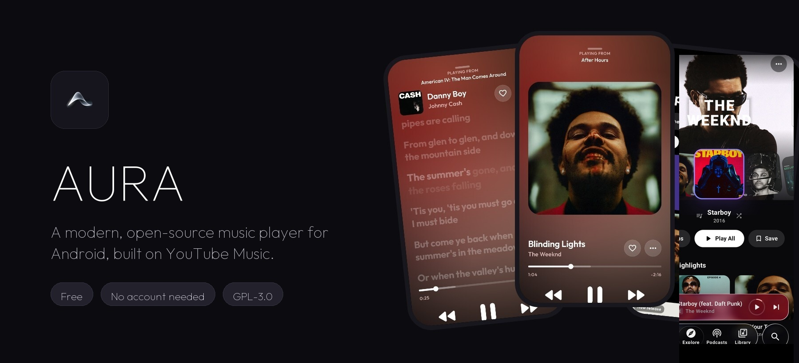
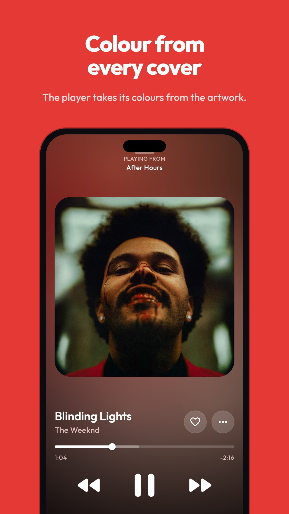
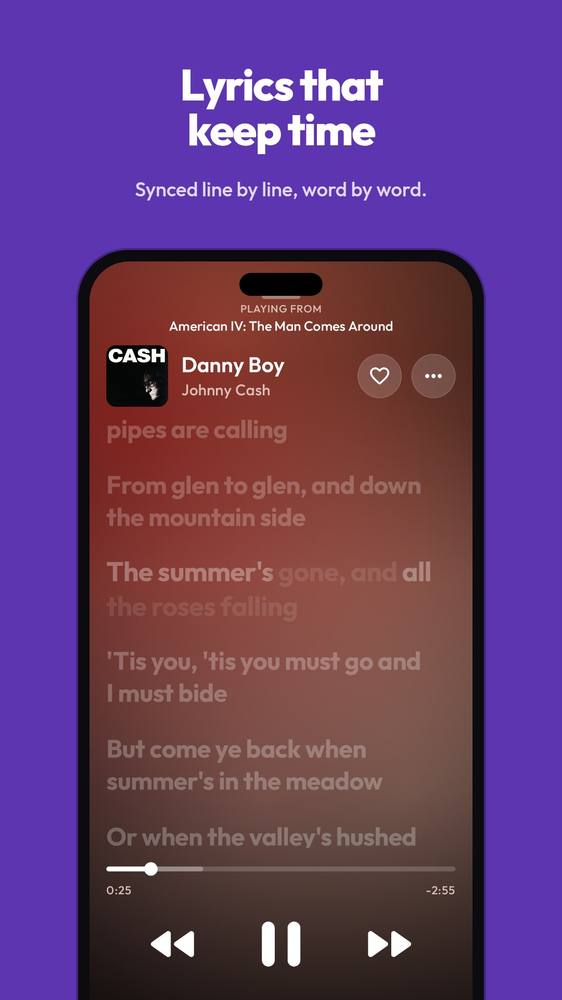
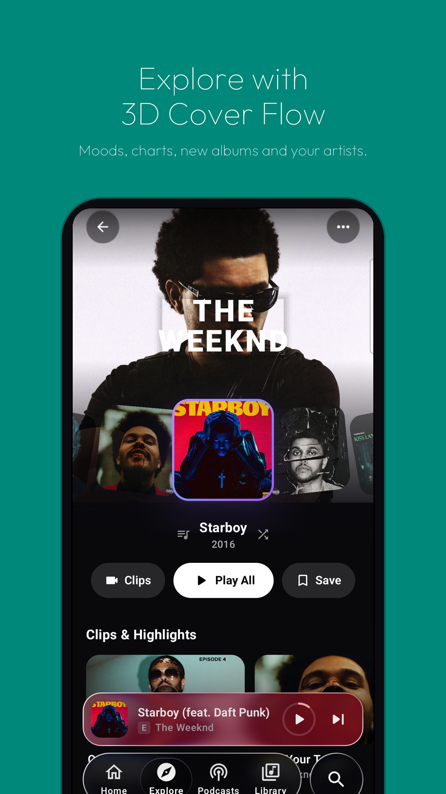
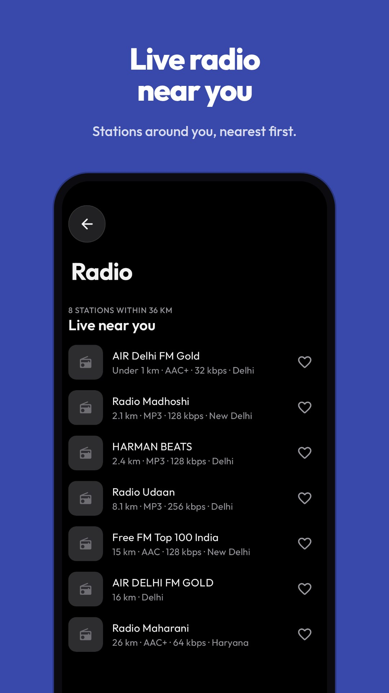
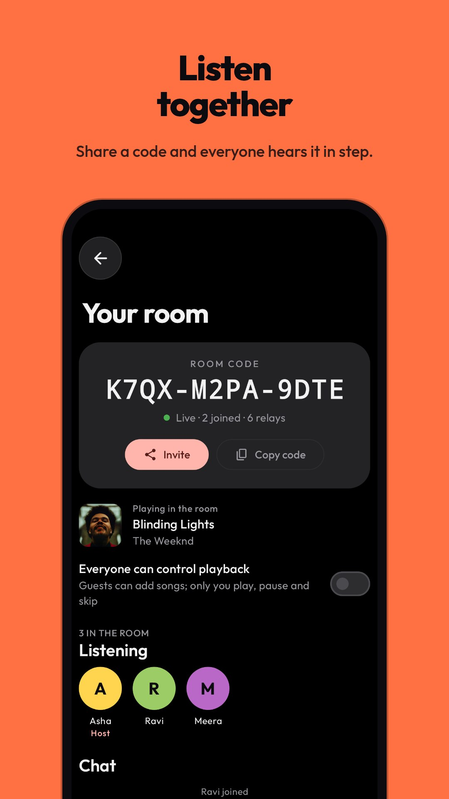
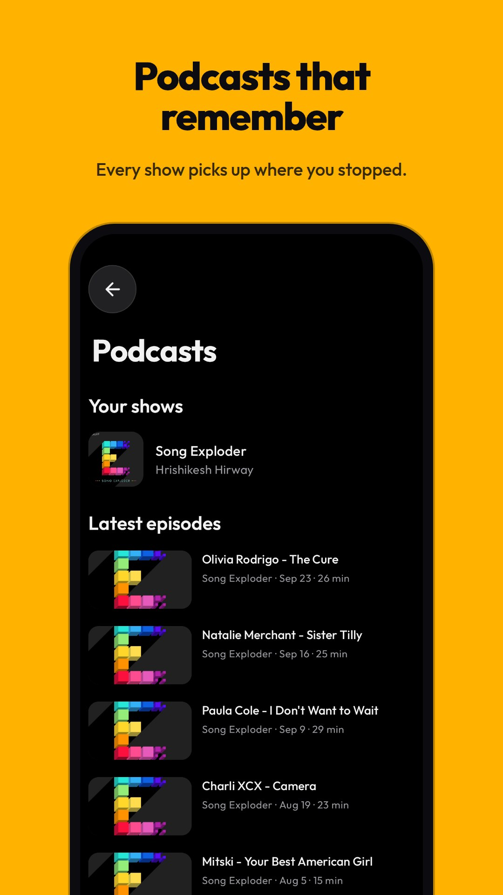

<p align="center">
  
</p>

<p align="center">
  <a href="https://github.com/HyperSpandan/AURA/releases/latest"><b>Download Latest APK</b></a>
  &nbsp;·&nbsp;
  <a href="https://hyperspandan.github.io/AURA/">Website</a>
  &nbsp;·&nbsp;
  <a href="#features">Features</a>
  &nbsp;·&nbsp;
  <a href="#building">Building</a>
  &nbsp;·&nbsp;
  <a href="#support-aura">Support</a>
</p>

<p align="center">
  <a href="https://github.com/HyperSpandan/AURA/actions/workflows/ci.yml"></a>
  
  
  <a href="LICENSE"></a>
  
</p>

---

# AURA

**AURA** is an open-source, beautifully designed music streaming application built for Android. Powered directly by YouTube Music’s internal API, AURA provides an ad-free, account-optional, high-fidelity listening experience wrapped in fluid, tactile, hardware-accelerated animations.

No accounts required. No subscription fees. No ads. Just pure music, audiophile-grade playback controls, and next-generation design.

---

## ✨ Key Highlights

- 🎨 **Next-Gen Visual Design**: 3D Cover Flow carousel, full-bleed animated album artwork, and fluid morphing capsule dock.
- 🎧 **Audiophile Sound Quality**: Lossless FLAC add-on integrations, 15-band EQ, AutoEq correction for 8,000+ headphones, bit-perfect USB DAC output, and loudness normalization.
- 🎤 **Pure Synced Lyrics**: Real-time word-by-word synced lyrics powered by LRCLIB, KuGou, and NetEase with organic glyph bloom and zero blocky borders.
- 👥 **Listen Together**: Synchronized, end-to-end encrypted rooms powered by decentralized Nostr relays—listen to tracks in exact step with friends.
- 🔒 **Privacy by Default**: No tracking, no mandatory sign-in. Sign in only if you wish to sync your YouTube Music likes and library.
- 📻 **Live Radio & Podcasts**: 50,000+ radio stations worldwide via Radio Browser, plus full podcast playback with resume tracking.
- 📺 **Multi-Device Support**: Optimized for Android phones, tablets, foldables, and Android TV (with quick phone QR pairing).

---

## 📸 Screenshots

<table>
  <tr>
    <td></td>
    <td></td>
    <td></td>
  </tr>
  <tr>
    <td></td>
    <td></td>
    <td></td>
  </tr>
</table>

---

## 🚀 Features

### 🎧 Listening & Audio Engine
- **Lossless & Hi-Res Audio**: Connect BitChord-compatible audio sources in **Settings → Audio → Audio add-ons** for automatic FLAC lossless upgrades.
- **Dual Stream Failover**: Seamlessly switches between InnerTubeX and native streaming resolvers to guarantee instant playback without dead links.
- **Loudness Normalization**: Per-track EBU R128 loudness leveling keeps volume consistent across varying albums and playlists.
- **AutoEq Headphone Correction**: Built-in parametric equalization profiles for over 8,000 headphone models.
- **Bit-Perfect USB DAC Mode**: Direct bit-exact audio routing bypasses Android's global resampler on Android 14+.
- **Acoustic Spatial Modes**: Built-in 8D audio and 3D spherical sound spatialization for headphones.
- **Smooth Crossfade & Gapless**: Configurable 1–12s equal-power crossfading for seamless transitions.
- **Offline Downloads**: High-speed track and album downloads with embedded metadata and synced lyrics for full offline playback.

### 🎨 Visuals & Modern Experience
- **3D Cover Flow Carousel**: Interactive gesture-driven cover flow on Explore spotlighting trending artists and top picks.
- **Fluid Morphing Capsule Dock**: An adaptive glass dock that expands when browsing and minimizes into a compact floating capsule when scrolling or playing.
- **Apple Music Animated Artwork**: Loops high-resolution motion art natively on supported albums and Spotify Canvas clips.
- **Organic Synced Lyrics**: Letterform-focused text illumination without distracting bounding boxes, floating words, or awkward squares.

### 📱 Connected Ecosystem
- **Listen Together**: Create a room, share the invite link or code (`aura://together/<code>`), and stream in lockstep with friends without central servers.
- **Song Recognition ("Name That Song")**: On-device audio fingerprinting matches music playing in the room through Shazam's database.
- **Android TV Support**: Native leanback TV UI with D-pad navigation and instant phone-based QR code sign-in.
- **Android Auto**: Full in-car dashboard navigation for Home, Liked tracks, playlists, and downloads.
- **Casting & DLNA**: Cast directly to Google Cast, smart TVs, network receivers, and DLNA speakers.

---

## 📥 Download & Installation

1. Head over to the [**Latest Releases**](https://github.com/HyperSpandan/AURA/releases/latest) page.
2. Download the APK suited for your device:
   - **`arm64-v8a`**: Recommended for almost all modern Android phones and tablets.
   - **`universal`**: Compatible with any Android device (phone, tablet, TV, emulator).
3. Tap the downloaded file to install. If prompted, grant your browser or file manager permission to install unknown apps.
4. **Auto-Updates**: AURA checks for new releases directly from GitHub and notifies you when an update is available.

---

## 🛠️ Building from Source

AURA is built using standard Gradle and the Android SDK.

### Prerequisites
- **JDK 17 or 21**
- **Android SDK** with platform `android-37` installed
- Environment variable `ANDROID_HOME` pointing to your Android SDK

### Build Commands
```bash
# Clone the repository
git clone https://github.com/HyperSpandan/AURA.git
cd AURA

# Run unit tests
./gradlew testDebugUnitTest

# Build Debug APK
./gradlew assembleDebug

# Build Universal Release APK
./gradlew assembleRelease -PuniversalOnly=true
```

Built APKs will be located at:
```text
app/build/outputs/apk/release/app-release.apk
```

---

## 💖 Support AURA

AURA is completely free, ad-free, and independently developed. If you love using AURA and want to support its ongoing development:

- **UPI (India)**: `auramusic@slc`
- **GitHub**: Star the repository at [HyperSpandan/AURA](https://github.com/HyperSpandan/AURA) and share it with fellow music lovers!

---

## ⚖️ Disclaimer

AURA is an independent third-party client and is not affiliated with, endorsed by, or associated with Google, YouTube, Spotify, or any of their subsidiaries. All product names, logos, trademarks, and registered trademarks belong to their respective owners.

---

## 📄 License

AURA is licensed under the [GNU General Public License v3.0](LICENSE).  
Third-party libraries and assets are credited in [THIRD_PARTY_NOTICES.md](THIRD_PARTY_NOTICES.md).
